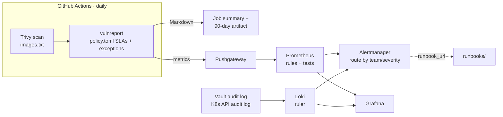

# observability-vuln-reporting

Vulnerability management and security observability as code:

- **`vulnreport`**: a small, dependency-free Python CLI that turns Trivy scans into **SLA-aware** reports (Markdown, JSON) and **Prometheus metrics**, with time-boxed risk acceptances that expire on their own
- **Prometheus alert rules** for SLA breaches, stale scans, Vault seal state, certificate renewal and secret sync, all **unit-tested with `promtool`**
- **Loki ruler alerts** on Vault and Kubernetes **audit logs**: root token use, permission-denied spikes, humans reading Secrets, `exec` and manual RBAC changes
- **Grafana dashboards** generated from Python, provisioned read-only (`allowUiUpdates: false`)
- **Runbooks** for every alert, linked from each alert's `runbook_url`
- A compose stack and smoke test proving the whole chain works end to end



## vulnreport

```bash
trivy image -f json -o app.json ghcr.io/example/app:1.4.2
vulnreport app.json --policy policy.toml --markdown - --metrics metrics.prom --fail-on-breach
```

Real output against an outdated image:

```
| | Artifact | Critical | High | Medium | Low | Fixable | SLA breaches | Accepted |
|---|---|---:|---:|---:|---:|---:|---:|---:|
| ❌ | `public.ecr.aws/nginx/nginx:1.25-alpine` | 3 | 17 | 43 | 30 | 93 | 93 | 0 |

## SLA breaches (93)
| Severity | ID | Artifact | Package | Installed → Fixed | Age | SLA |
| 🟥 CRITICAL | CVE-2024-45491 | `public.ecr.aws/nginx/nginx:1.25-alpine` | libexpat | 2.6.2-r0 → 2.6.3-r0 | 818d | 7d |
...
```

Design decisions:

- **Only fixable findings breach SLA.** Unfixable ones are tracked and start counting once a fix ships.
- **Risk acceptances expire.** Each `[[accept]]` needs an owner, a reason and a date. After that date it stops suppressing the finding and `RiskAcceptanceExpired` fires.
- **Stale data alerts.** If scans stop, `VulnerabilityReportStale` fires instead of the dashboard going quietly green.
- **`vuln_severity`, not `severity`.** Alert rules set a `severity` label for routing. The promtool tests caught that reusing the name overwrote the CVE severity, so the exporter uses its own label.
- **Standard library only**, so the tool that tracks patching has nothing of its own to patch.

Metrics: `vuln_findings{artifact,vuln_severity,fixable}`, `vuln_sla_breaches`, `vuln_oldest_fixable_age_days`, `vuln_risk_acceptances_expired`, `vuln_report_timestamp_seconds`.

## Alerts

| Alert | Source | Severity |
|---|---|---|
| `VulnerabilitySLABreachCritical` | Prometheus | critical |
| `VulnerabilitySLABreach` (HIGH/MEDIUM) | Prometheus | warning |
| `RiskAcceptanceExpired` | Prometheus | warning |
| `VulnerabilityReportStale` / `Missing` | Prometheus | warning |
| `VaultSealed` | Prometheus (Vault telemetry) | critical |
| `CertificateExpiringSoon` / `NotReady` | Prometheus (cert-manager) | warning |
| `ExternalSecretSyncFailing` | Prometheus (External Secrets) | warning |
| `VaultRootTokenUsed` | Loki (Vault audit) | critical |
| `VaultPermissionDeniedSpike` | Loki (Vault audit) | warning |
| `KubeSecretReadByHuman` / `KubeRBACChangedByHuman` / `KubeExecIntoPod` | Loki (K8s API audit) | warning/info |

Alertmanager routes by `team` and `severity`, and **inhibits** secret-sync and certificate alerts while `VaultSealed` is firing, so on-call gets the cause, not 40 symptoms.

## CI

| Workflow | What it proves |
|---|---|
| `ci` · python | ruff + pytest (≥90% coverage gate) on Python 3.11-3.13 |
| `ci` · rules | `promtool check rules`, **`promtool test rules`**, dashboards match their generator, shellcheck |
| `ci` · security | gitleaks over full history; Trivy fs scan (deps, misconfig, secrets) → Security tab |
| `ci` · smoke | compose stack up → Trivy fixture → Pushgateway → Prometheus → **alert in Alertmanager**; fake Vault root-token audit line → Loki → **alert in Alertmanager**; Grafana dashboards + datasources provisioned |
| `vulnerability-report` | daily scan of `images.txt` → report in the job summary + 90-day artifact (audit evidence) |

## Run it locally

```bash
export GRAFANA_ADMIN_PASSWORD=$(openssl rand -hex 16)
docker compose up -d --wait
./scripts/smoke-test.sh          # ~30s
open http://127.0.0.1:3000       # Security folder: Vulnerability management, Security audit
```

Containers run with a read-only root filesystem, no capabilities and `no-new-privileges`, with ports bound to localhost only.

## Layout

```
src/vulnreport/                  CLI: parse Trivy → apply policy → render md/json/prom
policy.toml                      SLAs + risk acceptances
images.txt                       images the daily report tracks
observability/prometheus/        rules/ + tests/ (promtool unit tests)
observability/loki/rules/        audit-log alert rules (Loki ruler)
observability/alertmanager/      routing + inhibition
observability/grafana/           build_dashboards.py → dashboards/*.json, provisioning
runbooks/                        one per alert
docs/patching-process.md         SLAs, exceptions, reporting, incident escalation
```
